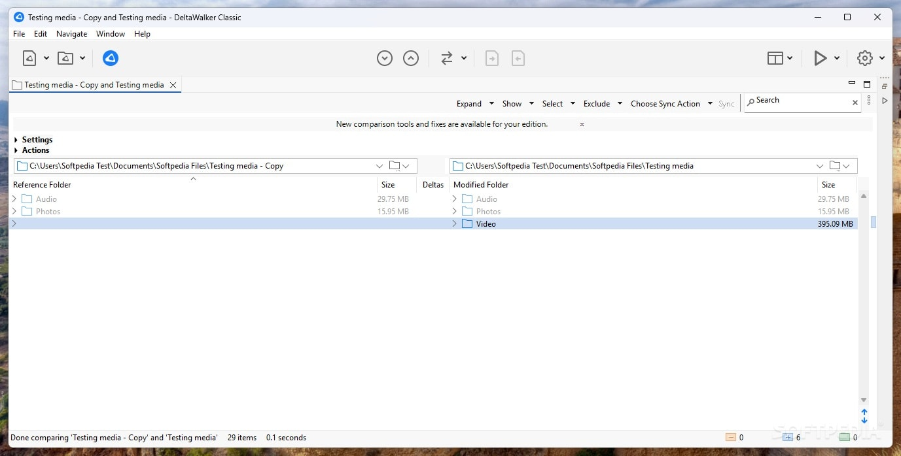
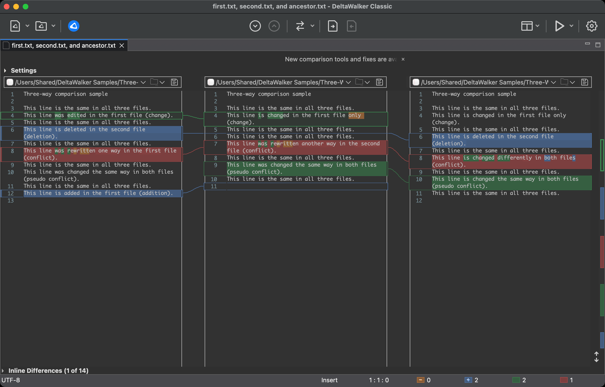

# DeltaWalker File Comparison and Folder Synchronization Guide

DeltaWalker compares files and folders so you can inspect changes before merging or synchronizing them.
This independent DeltaWalker Review covers practical workflows and the differences between product variants.
Readers looking for deltawalker web, deltawalker 3, or deltawalker pro should check which variant and edition a feature belongs to.

Deltopia develops the application.
The linked source files in this repository are WinMerge reference materials for studying comparable tools.

[](SILKA)

## What Can DeltaWalker Do?

DeltaWalker Classic provides several ways to examine differences.

| Material | Comparison approach | Review question |
| --- | --- | --- |
| Source files | Text comparison with inline changes | Which statements changed? |
| Project folders | Directory comparison with filters | Which entries are missing or different? |
| Branch revisions | Three-way comparison with an ancestor | Which edits overlap? |
| Images | Visual and pixel comparison | Where did the appearance change? |
| PDF and Office files | Comparison of extracted text | Did the document wording change? |
| Binary files | Byte-oriented inspection | Which stored bytes differ? |
| Archives | Inspection of supported archive contents | Which packaged resources changed? |

Three-way comparison and custom scripting require a suitable Classic edition.
Text extracted from a document does not represent every visual detail of its original layout.

A useful review sequence is:

1. Identify the reference version.
2. Select the modified version.
3. Confirm the comparison settings.
4. Inspect each meaningful difference.
5. Save only the changes you intend to retain.



Folder filters help keep generated output out of a source review.
Define exclusions carefully so that a clean result still covers the files you intended to inspect.

Comparable WinMerge definitions included here illustrate different filtering goals:

- [SourceControl.flt](Filters/SourceControl.flt) describes exclusions for version control metadata.
- [CSharp_loose.flt](Filters/CSharp_loose.flt) excludes common generated binaries in C# projects.
- [XML_html.flt](Filters/XML_html.flt) selects XML and HTML development files.

These are WinMerge filter files.
Recreate the intended selection in DeltaWalker settings rather than assuming the formats are interchangeable.

## Requirements

The DeltaWalker family includes Classic, Web, and the newer Desktop application.
Their release status and feature coverage differ.

| Variant | Execution environment | What to check |
| --- | --- | --- |
| Classic | Installed application for supported desktop platforms | Operating system, edition, and current release requirements |
| Web | Browser application currently offered in beta | Browser access to the chosen files and available beta features |
| Desktop | New application with an Apple Silicon Mac beta | Supported hardware and current beta availability |

Classic Pro licensing covers one operating system.
Classic Oro covers all supported operating systems.
Check the current product information before selecting a license.

The newer Desktop application and Classic are separate products within the same family.
An Apple Silicon Desktop beta does not establish equivalent availability on every desktop platform.

See the [official product overview](https://deltopia.com/en/products/deltawalker) for the current lineup.

## Running

DeltaWalker Classic accepts file or folder paths on its command line.
The following PowerShell example uses the documented default Windows executable location.

Replace the sample paths with existing resources on your machine.

```powershell
$deltaWalkerExe = 'C:\Program Files\Deltopia\DeltaWalker Classic\DeltaWalker.exe'
$reviewRoot = 'C:\Review'
& $deltaWalkerExe "$reviewRoot\baseline\settings.json" "$reviewRoot\candidate\settings.json"
```

The first resource is the reference in a two-way comparison.
The second resource is the modified version.

For a three-way file merge in Classic Pro or Oro, supply the two modified files before the ancestor.
The output argument selects the file that receives the saved merge result.

```powershell
$deltaWalkerExe = 'C:\Program Files\Deltopia\DeltaWalker Classic\DeltaWalker.exe'
$reviewRoot = 'C:\Review'
& $deltaWalkerExe "$reviewRoot\branch-a.json" "$reviewRoot\branch-b.json" "$reviewRoot\ancestor.json" "-merged=$reviewRoot\resolved.json"
```

Opening the comparison does not decide how a conflict should be resolved.
Inspect the panes and save the intended result.
See the [Classic command line reference](https://deltawalker.com/integrate/command-line) for argument ordering and edition restrictions.

## Folder Structure

The included source snapshot contains selected WinMerge components.
It provides comparison material for archive handling, appearance, and operating system integration.
It is a partial snapshot and is not presented as a complete buildable application.

| Included area | Reference purpose |
| --- | --- |
| Archive support | Study how a comparison tool connects to archive services |
| Color schemes | Inspect stored appearance preferences |
| Shell extension | Examine Windows integration boundaries |
| Maintenance scripts | Review resource and translation checks |

Archive integration references:

- [Merge7z.cpp](ArchiveSupport/Merge7z/Merge7z.cpp) contains WinMerge archive integration implementation.
- [tools.cpp](ArchiveSupport/Merge7z/tools.cpp) provides supplementary Merge7z utilities.
- [Merge7zCommon.h](ArchiveSupport/Merge7z/Merge7zCommon.h) brings archive support dependencies together.

Appearance and language references:

- [VS Dark.ini](ColorSchemes/VS%20Dark.ini) stores a WinMerge color scheme.
- [LanguageSelect.cpp](ShellExtension/Common/LanguageSelect.cpp) implements shell extension language selection.
- [UnicodeString.cpp](ShellExtension/Common/UnicodeString.cpp) contains Unicode string support code.

They do not establish which libraries DeltaWalker uses internally.

## Developing

Classic supports JavaScript automation through its own application scripting environment.
The following original example reports the running version and edition without changing compared files.

```javascript
const version = App.getVersion();
const edition = App.getEdition();
console.log('Review environment: ' + version);
console.log('Active edition: ' + edition);
```

Run application scripts through the supported Classic scripting interface.
The application-provided App object is required; this is not a standalone browser or Node.js example.
Custom scripting is available in Classic Pro and Oro, with access also described for the trial.

The [Classic scripting documentation](https://deltawalker.com/scripting/scripting) explains supported entry points and asynchronous operations.

Windows integration can also be studied separately in the included WinMerge sources:

- [WinMergeContextMenu.cpp](ShellExtension/Common/WinMergeContextMenu.cpp) implements comparison context menu behavior.
- [RegKey.cpp](ShellExtension/Common/RegKey.cpp) wraps access to Windows registry settings.
- [AppxManifest.xml.in](ShellExtension/WinMergePkg/AppxManifest.xml.in) declares WinMerge package integration metadata.

## Documentation

For folder synchronization, review the proposed direction before applying changes.
A newer timestamp alone does not prove that a file contains the version you want.

A repeatable folder review should record:

- The reference and destination locations.
- Active include and exclude rules.
- Whether comparison uses content or metadata.
- How conflicting edits will be handled.
- Which copy, replacement, and deletion actions are proposed.



Folder selection and text filtering answer different questions.
The first determines which entries participate; the second determines how selected text is compared.
Consult the [folder filter documentation](https://deltawalker.com/preferences/folder-comparisons/filters) when defining the scope.

For remote work, confirm the edition and protocol before planning a transfer.
Classic documents writable remote connections for supported FTP and WebDAV services, while HTTP resources are read-only.
Avoid assuming that a feature available in Classic has already reached the Web or Desktop beta.

The [Classic feature matrix](https://deltawalker.com/features) documents edition differences.

## Contributing

Useful review feedback includes the product variant, version, edition, operating system, and a reproducible comparison case.
For a filtering problem, describe both an entry that should be included and one that should be excluded.

The included WinMerge maintenance files show how another comparison project checks interface resources:

- [CheckUnusedResources.js](Tools/Scripts/CheckUnusedResources.js) searches for potentially unused resource identifiers.
- [CheckMenuResources.js](Tools/Scripts/CheckMenuResources.js) checks menu resource usage.
- [CheckTranslationStrings.ps1](Tools/Scripts/CheckTranslationStrings.ps1) checks extracted source strings against resources.
- [UpdateTranslations.bat](Tools/Scripts/UpdateTranslations.bat) coordinates translation maintenance steps.

Their presence is documentation material, not a requirement to execute them.

## Contact

Use Deltopia's official website for product support, licensing questions, and release information.
For problems with this independent review, describe the affected paragraph or reference link.

## Related Search Terms

DeltaWalker, DeltaWalker Review, deltawalker web, deltawalker 3, deltawalker pro, compare-files, diff, merge, text-diff, image-comparison, image-diff, editor, git, windows, file-synchronization
